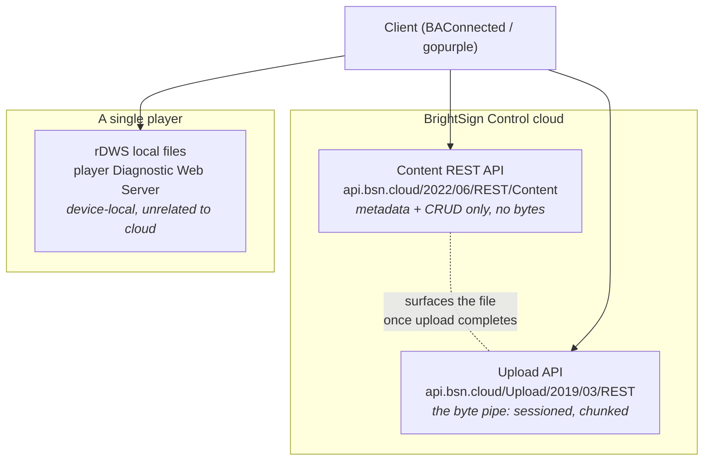
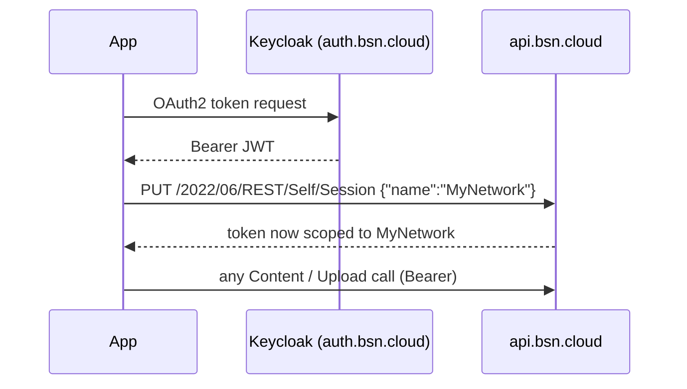
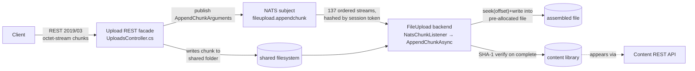
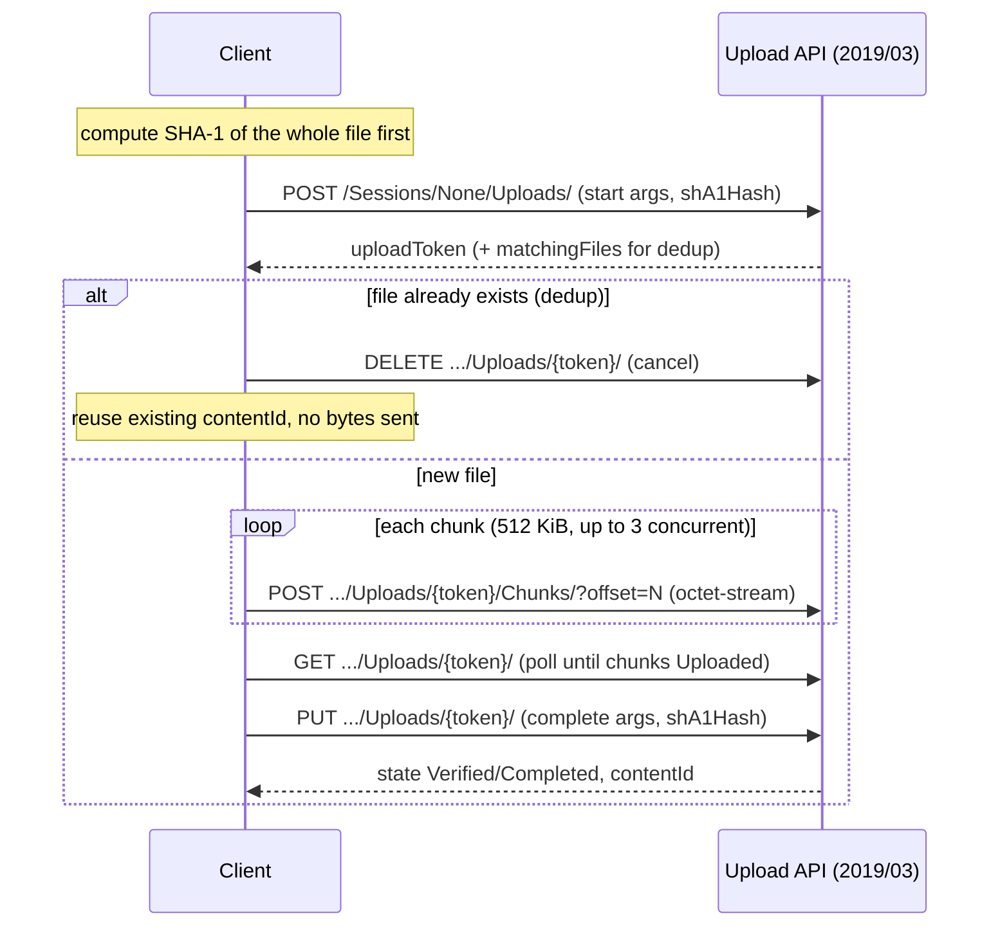

# BrightSign Content API — How It Actually Works

How content files move in and out of a BrightSign Control network (the cloud service formerly
called BSN.cloud), and exactly what the wire payloads must contain for an upload to succeed.

This document exists because the upload protocol is not written down anywhere in prose. The REST
metadata API is documented (`web-services-apis.md`, OpenAPI YAML). The *upload* side is documented
only in code — the reference client (`BAConnected/packages/bsnConnector`) and the .NET backend
(`bsn-core/bsn-cloud-*`). Several fields the server requires are computed client-side and never
appear in any spec. Those are the parts most likely to make a from-scratch client silently fail,
so they get their own section (see [What BSN actually needs](#5-what-bsn-actually-needs-the-undocumented-payload)).

Sources are cited as `repo/path:line` throughout. Absolute example hosts use production
(`api.bsn.cloud`); the reference client defaults to staging (`api.bsn-staging.net`).

---

## 1. Three different "file" systems

"Content" is overloaded. There are three distinct APIs, and conflating them is the most common
mistake.



| System | Base URL | Purpose | gopurple examples |
|--------|----------|---------|-------------------|
| **Content REST** | `https://api.bsn.cloud/2022/06/REST/Content` | List / get / delete / folders / tags / permissions. **No upload endpoint.** | `main-content-list`, `main-content-delete`, `main-content-download` |
| **Upload** | `https://api.bsn.cloud/Upload/2019/03/REST` | Push file bytes into the content library. Separate host path, older API version, chunked session protocol. | `main-content-upload` |
| **rDWS** | player-local | Files on a specific player's storage. A different API entirely. | `rdws-files-*` |

Two facts that follow from this split:

- **You cannot upload through the Content REST API.** It has no create-by-upload route. Bytes only
  enter the library through the Upload API. (`bsn-core/.../REST/ContentController.cs`)
- **The Upload API is a different service on an older version** (`2019/03` vs `2022/06`) with its own
  content-negotiated media types. A client that assumes one base URL for everything will not work.

---

## 2. Authentication and network scoping

Both cloud systems use the same auth, and both require a network to be selected first.

- **OAuth 2.0 Bearer tokens from Keycloak** (`https://auth.bsn.cloud/realms/bsncloud/...`). Every
  request carries `Authorization: Bearer <token>`. (`bsn-core/docs/web-services-apis.md:15-62`)
- **Network scope is mandatory.** Before any content call, select the network:
  `PUT /2022/06/REST/Self/Session` with body `{ "name": "<networkName>" }`. The scope lives inside
  the token — there is no separate network header. (`BAConnected/.../session.ts:1006`, `common.ts`)
- Every route is gated by a named permission (`bsn.api.main.content.retrieve|create|update|delete`);
  a missing permission is `403`, not `401`.



In gopurple this is `authManager.EnsureValid` + `EnsureNetworkSet`, called at the top of every
content operation (`gopurple/internal/services/content.go:57-62`).

---

## 3. Content REST API (metadata and CRUD)

Base: `https://api.bsn.cloud/2022/06/REST/Content`. Controller:
`bsn-core/.../Main/v202206/REST/ContentController.cs`.

| Method | Path | Purpose | gopurple |
|--------|------|---------|----------|
| GET | `/Content` | List items (marker-paginated) | `ContentService.List` ✅ |
| GET | `/Content/Root/{*virtualPath}` | List items in a virtual folder | ❌ |
| GET | `/Content/Count` | Count (respects `filter`) | `GetCount` ✅ |
| GET | `/Content/{id}` | Get metadata (JSON/XML) | `GetByID` ✅ |
| GET | `/Content/{id}` (`Accept: image/*`) | Thumbnail bytes, `?maxWidth=`/`?maxHeight=` (default 100×100) | ❌ |
| POST | `/Content/Root/{*virtualPath}` | Create a folder → `201`, returns `ContentFolder` | ❌ |
| PUT | `/Content/{id}` | Update metadata (name/description); rejects folders/presentations | ❌ |
| PATCH | `/Content/{id}` | Partial update (JSON-Patch) | ❌ |
| GET/POST/DELETE | `/Content/{id}/Tags` | Tag map get/add/remove | ❌ |
| DELETE | `/Content` | Bulk delete by filter (excludes folders) | `Delete` ✅ |
| DELETE | `/Content/{id}` | Delete one (rejects folders) | `DeleteByID` ✅ |
| GET | `/Content/Operations` | Operation/permission metadata | ❌ |
| GET/POST/DELETE | `/Content/{id}/Permissions` | Object permissions | ❌ |

### Query parameters (list/count)

`?marker=` (pagination cursor), `filter=`, `sort=`, `pageSize=`, joined with `&`.
(`BAConnected/.../enumerator.ts:21-49`) Example filter: `[FileName] IS 'clip.mp4' AND [VirtualPath] IS '\videos\'`.

### Content entity (response model)

Server-computed. The client never sends most of these — it reads them back after upload.

| Field | Type | Notes |
|-------|------|-------|
| `id` | number | Content ID |
| `fileName` | string | |
| `physicalPath` / `virtualPath` | string | virtualPath in **backslash** form (see §5) |
| `thumbPath` | string | server-generated thumbnail URL |
| `mediaType` | enum | `Image`/`Video`/`Audio`/`Folder`/… |
| `fileSize` | number | |
| `fileHash` | string | may carry a `SHA1:` prefix in responses |
| `uploadDate` / `lastModifiedDate` / `fileLastModifiedDate` | date | ISO `T` form |
| `metadata` | object | server-computed (codec, dimensions, duration…) |
| `probeData` | string | server-computed ffprobe output |

(`BAConnected/.../entities.ts:37-57`; folder variant `:60-71`.)

### Move / rename (change virtual path)

`PATCH /Content/{id}/` with `Content-Type: application/json-patch+json`:

```json
[ { "op": "replace", "path": "/virtualPath/", "value": "\\new\\path\\" } ]
```

`op` is the lowercase literal `replace`; `path` has a trailing slash. Value is backslash form.
(`BAConnected/.../operations/content.ts:239-262`)

### Create folder

`POST /Content/Root/{virtualPath}` (virtualPath POSIX with a leading `/`), body:

```json
{ "name": "NewFolderName" }
```

(`BAConnected/.../operations/content.ts:271-284`)

---

## 4. Upload API (the byte pipe)

Base: `https://api.bsn.cloud/Upload/2019/03/REST`. This is a **sessioned, chunked, hash-verified**
protocol using vendor-specific content types. It is not multipart, not a presigned URL, not gRPC
from the client's point of view (the gRPC/NATS machinery is internal to the backend).

### 4.1 Backend architecture (why it behaves the way it does)



Consequences you can observe from the client:

- On `StartFileUpload` the server **pre-creates a zero-filled file** of the declared length, then
  chunks seek-and-write into it by offset. Declaring the wrong `fileSize` breaks assembly.
  (`bsn-core/.../FileUploadService.cs:212-228, 948-979`)
- Completion computes **SHA-1** over the assembled file and compares to the client-supplied hash.
  Mismatch → state `Corrupted` + `FileVerificationFault`. (`FileUploadService.cs:439-462`)
- State is process-local and reaped: abandoned sessions are purged by a background job. Uploads are
  not durable across long stalls. (`FileUploadService.cs:1051`)

> **Hash gotcha:** the Content *metadata* model documents `fileHash` as MD5, but the upload engine
> computes and verifies **SHA-1**. Send SHA-1. gopurple already does (`upload.go:113`).

### 4.2 The four-step upload flow



`sessionToken` is the literal string `None` in the URL for a plain single file. An explicit
`POST /Sessions` is only used for multi-file/web-page uploads.
(`BAConnected/.../upload/uploadFileItem.ts:408-412, 603-648`)

### 4.3 Exact requests

**Start** — `POST /Upload/2019/03/REST/Sessions/None/Uploads/`
Content-Type: `application/vnd.bsn.start.content.upload.arguments.201903+json`
Accept: `application/vnd.bsn.content.upload.status.201903+json, application/vnd.bsn.content.upload.negotiation.status.201903+json, application/vnd.bsn.error+json`

```json
{
  "sessionToken": null,
  "uploadToken": null,
  "fileName": "clip.mp4",
  "virtualPath": "\\videos\\",
  "mediaType": "Video",
  "fileSize": 12345678,
  "fileLastModifiedDate": "0001-01-01 00:00:00Z",
  "shA1Hash": "3f2b1c...lowercasehex",
  "fileThumb": null
}
```

**Chunk** — `POST /Sessions/None/Uploads/{uploadToken}/Chunks/?offset=N`
Content-Type: `application/octet-stream`. Body: raw chunk bytes (no encoding).

**Poll** — `GET /Sessions/None/Uploads/{uploadToken}/`
Accept: `application/vnd.bsn.content.upload.status.201903+json`. Repeat until the chunk status
reports `Uploaded` (the server lags behind the last chunk POST; the reference client polls up to
20× at 500 ms). (`uploadFileItem.ts:701-747`)

**Complete** — `PUT /Sessions/None/Uploads/{uploadToken}/`
Content-Type: `application/vnd.bsn.complete.content.upload.arguments.201903+json`. Body is the same
argument object as start **except** `fileLastModifiedDate` now carries the real ISO date and
`uploadToken` is populated. Response gives final `state` + `contentId`.

### 4.4 Full vendor content-type set

From `enum UploadAcceptHeader` (`uploadFileItem.ts:61-90`). Send these exactly.

| Purpose | Media type |
|---------|-----------|
| Start upload (CT) | `application/vnd.bsn.start.content.upload.arguments.201903+json` |
| Complete upload (CT) | `application/vnd.bsn.complete.content.upload.arguments.201903+json` |
| Chunk (CT) | `application/octet-stream` |
| Upload status (Accept) | `application/vnd.bsn.content.upload.status.201903+json` |
| Negotiation status (Accept) | `application/vnd.bsn.content.upload.negotiation.status.201903+json` |
| Chunk status list (Accept) | `application/vnd.bsn.upload.content.chunk.status.list.201903+json` |
| Error (always in Accept) | `application/vnd.bsn.error+json` |

Update (vs new upload), web-page, and web-page-asset flows have parallel `...update...`,
`...webpage.upload...`, and `...webpage.asset.upload...` variants — same shape, different noun.

### 4.5 Response / status shape

`BsnFileUploadStatus` (`uploadFileItem.ts:151-164`). Exact keys the client reads:

```
uploadToken, contentId, fileName, fileSize, shA1Hash, state,
startTime, endTime, lastActivityTime,
chunks: [ { count, length, state } ],
matchingFiles?: [ { id, fileName, virtualPath, mediaType, fileSize, shA1Hash, uploadDate } ]
```

`state` (`FileUploadState`, `:34-47`) is one of:
`Unknown, Queued, Started, Uploading, Stopped, Uploaded, Verified, Cancelled, Corrupted, Collected, Terminated, Completed`.

Treat `Verified`/`Completed` as success; `Corrupted`/`Cancelled`/`Terminated` as terminal failure;
keep polling on `Started`/`Uploading`.

---

## 5. What BSN actually needs — the undocumented payload

These fields are computed by the client and appear in no REST or OpenAPI spec. This is the section
that closes the knowledge gap. Get any of these wrong and the upload fails or silently misbehaves.

### 5.1 `shA1Hash` — exact key casing

The JSON key is **`shA1Hash`** — capital `A`, everything else lowercase. Not `sha1Hash`, not
`sha1hash`, not `SHA1Hash`. The value is a **lowercase hex** SHA-1 digest of the whole file, with no
`SHA1:` prefix and no colons. (`uploadFileItem.ts:117, 591-593`; `cryptoOperations.ts:75-79`)

> The .NET backend's JSON binding may be case-insensitive, so `sha1Hash` can appear to work. Do not
> rely on it — match the reference client exactly.

### 5.2 `fileLastModifiedDate` — the sentinel, and why

On **start**, the client sends the literal string:

```
"fileLastModifiedDate": "0001-01-01 00:00:00Z"
```

Note the **space** between date and time (not the `T` ISO form). This is `NullDateString`
(`entities.ts:33`). It is deliberately nulled so the server's dedup match ignores modification time
— matching happens on **name + virtualPath + size + hash** only. (`uploadFileItem.ts:595-601`)

On **complete**, the same field carries the real modification date in `T` ISO form
(`"2026-08-18T12:34:56.000Z"`).

### 5.3 `virtualPath` — backslash encoding

BSN virtual paths use **backslashes**, with an enforced trailing (and usually leading) `\`. The
client converts a normal POSIX path before sending. (`common.ts:944-953`)

| Input (POSIX) | Sent to BSN | JSON-escaped |
|---------------|-------------|--------------|
| `videos/promos` | `\videos\promos\` | `"\\videos\\promos\\"` |
| (empty) | `\` | `"\\"` |
| `/videos/` (leading slash) | `\videos` | leading `\` suppressed — a known quirk |

In `filter=` query strings the separator is doubled (`\\`) and single quotes are escaped by doubling.
Root is `\`.

### 5.4 `mediaType` — detected from extension

Value strings (`enum BsnUploadMediaType`, `uploadFileItem.ts:92-103`):
`Auto, Text, Image, Video, Audio, Font, Stylesheet, Auxiliary, WebPage, DeviceWebPage`.
Note CSS maps to the string `Stylesheet`, not `Css`.

The client auto-detects from the file extension (`bscGetFileMediaType`, `bsCore/lib/assets.ts`):

| mediaType | Extensions |
|-----------|-----------|
| `Image` | jpg, jpeg, png, bmp |
| `Video` | mov, mp4, mpg, ts, vob, wmv, m2ts, mkv, webm |
| `Audio` | mp3, wav, ogg, flac, m4a, aac, ac3, eac3, ec3 |
| `Text` | txt |
| `Font` | ttf, otf, ttc |
| `Stylesheet` | css |
| `Auxiliary` | anything else |

Unknown extensions map to `Auxiliary`; in practice the literal `Auto` is essentially never emitted
by detection. Sending a correct concrete type is safer than sending `Auto`.

### 5.5 `fileThumb`, `tags`, `metadata`, `probeData` — do NOT send these

- **`fileThumb`** is always the literal `null`. The client never generates an upload thumbnail; BSN
  generates `thumbPath` server-side. (`uploadFileItem.ts:118, 307`)
- **`tags`** is not in the upload payload at all (only a commented-out placeholder). Tags are applied
  afterward via a separate `PATCH /Content/{id}/Tags`. (`uploadFileItem.ts:308`)
- **`metadata` / `probeData`** (codecs, dimensions, duration) are computed by BSN server-side. The
  client sends none of it and simply re-fetches the entity after upload to read them back.
  (`entities.ts:49-50`)

### 5.6 Chunking details

- Reference client: **512 KiB** chunks, up to **3 concurrent**, `?offset=` query param, raw
  `octet-stream` body. (`uploadFileItem.ts:277, 364-379, 827-845`)
- gopurple: **5 MiB** chunks, sequential. Both are valid — the protocol is offset-based, so chunk
  size and concurrency are the client's choice as long as offsets and total size are correct.
- After the last chunk, **poll** — the server marks chunks `Uploaded` slightly after the POST
  returns. Completing before that yields an incomplete-assembly error.

### 5.7 Dedup / `matchingFiles`

The start response may include `matchingFiles`. The client treats an entry as a true duplicate only
when its `virtualPath` equals the upload's `virtualPath` (BSN already matched on name+size+hash). On
a match it cancels the upload (`DELETE .../Uploads/{token}/`), reuses the existing `contentId`, and
sends zero chunk bytes. (`uploadFileItem.ts:922-939`)

---

## 6. Download

Downloading does **not** stream bytes from `GET /Content/{id}`. That route returns metadata (or a
thumbnail with `Accept: image/*`). To get the actual file:

1. `GET /Content/{id}` → read the entity's `fileUrl` (a direct/static URL).
2. `GET {fileUrl}` → stream the bytes.

(`BAConnected/packages/bsn-content-migrator/src/downloadContent.ts:59`)

> gopurple currently downloads via `GET /Content/{id}/Download` (`content.go:254`). Verify this route
> against the live API — the reference client uses the two-step `fileUrl` approach above. This is the
> one place gopurple's content path diverges from the reference client and should be confirmed.

---

## 7. rDWS player-local files (for contrast)

The `rdws-files-*` examples talk to a player's Diagnostic Web Server directly and manage files on
that device's storage. This is a device-local API with nothing to do with the cloud content library
— different host, different auth, different data model. Covered by the rDWS docs, not here.

---

## 8. gopurple status and discrepancies vs the reference client

**Implemented:** List, Count, GetByID, Delete (bulk + by ID), single-file Upload, Download.
**Not implemented:** folders (`/Content/Root/...`), tags, permissions, PUT/PATCH update, move/rename,
thumbnails.

Where gopurple's upload differs from the reference client — worth auditing before relying on it for
non-video/large files:

| Item | Reference client | gopurple (`upload.go`) | Risk |
|------|------------------|------------------------|------|
| Hash JSON key | `shA1Hash` (cap A) | `sha1Hash` (`:209, 337`) | Works only if server binding is case-insensitive. Align the key. |
| `fileLastModifiedDate` sentinel | `0001-01-01 00:00:00Z` (space) | `0001-01-01T00:00:00` (T, no Z) (`:208`) | Different literal; confirm the server treats it as "null". |
| `virtualPath` | backslash form `\videos\` | passed through as given (e.g. `/videos/`) | Forward-slash paths may not resolve to the same folder. Convert to BSN backslash form. |
| `mediaType` | detected (`Video`, …) | always `Auto` (`:207`) | Server must auto-detect; concrete type is safer. |
| `tags` | omitted | sends `{}` | Harmless but non-standard. |
| Download | 2-step via `fileUrl` | `GET /Content/{id}/Download` | Verify route exists. |

The unused `ContentUploadArguments` struct (`types.go:1544`) uses PascalCase keys
(`FileName`, `SHA1Hash`) that match neither the wire format nor the actual code (which builds a
camelCase map in `upload.go`). It should either be corrected to the real wire shape and used, or
removed.

---

## References

**Reference client (BAConnected):**
- `packages/bsnConnector/lib/upload/uploadFileItem.ts` — the entire upload protocol
- `packages/bsnConnector/lib/operations/content.ts` — Content CRUD, folders, tags, move
- `packages/bsnConnector/lib/entities.ts` — content + upload data models
- `packages/bsnConnector/lib/common.ts` — URL builders, path/date/tag encoders, headers

**Backend (bsn-core):**
- `docs/web-services-apis.md` / `.yml` — authoritative REST reference + OpenAPI spec
- `.../Main/v202206/REST/ContentController.cs` — Content REST controller
- `.../Upload/v201903/REST/UploadsController.cs` — Upload REST facade
- `bsn-cloud-fileupload/BSN.Cloud.FileUpload/FileUploadService.cs` — chunk assembly + SHA-1 verify
- `.../Upload/v202311/Stream/NatsChunkListener.cs` — NATS chunk ingestion

**gopurple:**
- `internal/services/upload.go` — session-based chunked upload
- `internal/services/content.go` — Content REST client
- `internal/types/types.go:1481+` — content/upload structs
- `docs/all-apis.md` — endpoint inventory with SDK coverage status

---

*Last updated: 2026-08-18.*
