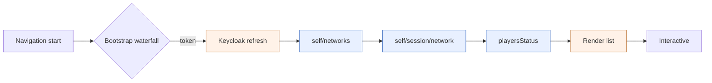

# Latency instrumentation and backend-vs-frontend isolation tests

**Goal:** Actively measure where a slow page spends its time and attribute it to the
backend, the network, front-end serialization, or browser render. Document 1 answers
"is the backend slow?" from existing metrics. This document builds the tooling to
answer "if not the backend, then what?" and to isolate the same action run against
the API directly versus through the UI.

This is a build plan. It describes three pieces of test tooling plus one small
backend change. None of it modifies existing application behavior: the harnesses are
new, self-contained programs, and the one server change is an additive response
header.

Prerequisite reading: [`01-backend-latency-from-existing-observability.md`](./01-backend-latency-from-existing-observability.md).

---

## 1. The measurement model

For any page or action, decompose the wall-clock into four terms:

```
T_total = T_backend + T_network + T_serialization + T_client
```

| Term | What it is | Measured by |
|---|---|---|
| **T_backend** | Time inside the server, summed on the critical path | resty `ServerTime`, OTel histogram, or `Server-Timing` header |
| **T_network** | Transit + TLS | resty `TotalTime - ServerTime`, or Resource Timing |
| **T_serialization** | Idle gaps **between** calls caused by the front-end running them in a dependent chain | Resource Timing interval-overlap |
| **T_client** | Render / transform after the last byte arrives | `PerformanceObserver`, last-byte-to-interactive |

The purpose of the whole exercise is to separate three very different problems that
all feel like "the page is slow":

1. **The backend is slow** (T_backend) — a server or DB fix.
2. **The front-end serializes fast calls** (T_serialization) — a front-end
   architecture fix (parallelize / prefetch).
3. **The browser renders slowly** (T_client) — a front-end render fix.



The front-end analysis found exactly this shape in `bs-management-cloud-ui`: a
serial, `enabled`-gated chain (Keycloak token to `self/networks` to
`self/session/network` to `playersStatus`), with a possible blocking Keycloak
`updateToken(5)` **inside** the axios request interceptor. The device-list call
itself is a single request, not N+1. So the model predicts the dominant cost is
`T_serialization` + Keycloak, not `T_backend`. The tests below confirm or refute
that.

---

## 2. Correlation key

To line up one browser request with its backend span, requests need a shared id and
the server must return its own processing time to the browser. That is the
`Server-Timing` + `X-Request-Id` + `Timing-Allow-Origin` header set in section C.
Until that exists, the Go harness (section A) is the authoritative source of
`T_backend`, because resty measures server time from the client side without needing
any server cooperation.

---

## A. Backend-only timing harness (gopurple) — step 2

**What it is:** a new, small Go program that drives the Main API through the gopurple
SDK with request tracing enabled, issuing the **same calls a page makes** but with no
browser involved. It establishes the pure backend + network floor.

**Why gopurple:** the SDK's HTTP client is resty, whose per-request trace yields
`DNSLookup`, `ConnTime`, `TLSHandshake`, `ServerTime` (the key signal: backend
processing + RTT after the request is written), `ResponseTime`, `TotalTime`, and
`IsConnReused`. The client is built once with keep-alive on, so warm calls reuse the
connection and DNS/TLS fall to zero.

**No edits to `internal/`:** `internal/http/http.go:364` exposes the raw client via
`GetClient()`. The harness attaches its trace hooks there:

```go
// Illustrative — lives in a new program, not in internal/.
raw := client.GetClient() // *resty.Client
raw.OnBeforeRequest(func(_ *resty.Client, r *resty.Request) error {
    r.EnableTrace()
    return nil
})
raw.OnAfterResponse(func(_ *resty.Client, resp *resty.Response) error {
    ti := resp.Request.TraceInfo()
    record(resp.Request.URL, ti.ServerTime, ti.TotalTime, ti.IsConnReused)
    return nil
})
```

**What it measures:**

1. **Cold start tax.** A fresh client's first operation pays three round-trips:
   token POST to the token endpoint, `PUT /Self/Session/Network`, then the data GET
   (`internal/auth/auth.go:91,144`; `internal/services/devices.go:71-77`). Time this
   separately and label each round-trip by URL — it is a one-time cost per process,
   not per call, and must not be blended into the per-call numbers.
2. **Warm per-call latency.** Re-using one long-lived client (token cached beyond the
   30s margin, network session cached), loop each target operation N = 50-100 times
   and report p50/p90/p99 of `ServerTime` and `TotalTime`.
3. **Parallel vs page-order.** Run the page's set of calls two ways:
   - **parallel** — the minimum achievable if the front-end issued them concurrently;
   - **serial, in the page's actual order** — reproduces the waterfall without a
     browser.
   The delta between these two **is** the cost the front-end waterfall adds, measured
   independently of rendering. This is the single most useful output of the harness.

**Target operations** (wrap the existing example binaries, which already trigger
these exact calls):

| Operation | SDK call | Example binary |
|---|---|---|
| List devices | `Devices.List` | `main--devices-list` |
| List subscriptions / count | `Subscriptions.List` / `GetCount` | `main-subscriptions-list`, `main-subscription-count` |
| List groups | `Devices.ListGroups` | `main-group-info` |
| B-Deploy setups | `BDeploy.GetSetupRecords` | `bdeploy-list-setups` |

Avoid the `*BySerial` device methods for floor measurement unless you specifically
want to measure fan-out: several do an internal `Get(serial)` then the ID operation
(2 calls), and `GetErrors` does 3 (`internal/services/devices.go:235,285,745-833`).
`BDeploy.GetAllDevices`/`GetDeviceBySerial` do a speculative double-fetch on the
empty result path (`internal/services/bdeploy.go:388-399,450-461`). These are worth
a separate line item but will distort a "single GET" floor.

**Output:** one row per operation — `op, mode(parallel|serial|cold), n, ServerTime
p50/p90/p99, TotalTime p50/p90/p99, conn_reused%`. Emit JSON or CSV so it can be
diffed against the UI run (section B) and the Grafana numbers (document 1).

**Build and run:** through `make` only (house rule — never `go build`/`go test`
directly). The Makefile already has `build`/`run-tests`/`check`. Put the harness
under `examples/` or a new `perf/` program in the gopurple repo and add a `make`
target for it. Credentials come from the environment the examples already use
(`BS_CLIENT_ID` / `BS_SECRET` / `BS_NETWORK`).

> Note: this harness naturally belongs in the **gopurple** repo, not purplebuilder.
> This document describes it; the code lands there.

---

## B. UI-triggered timing (axios interceptor + Playwright) — step 3

**What it is:** instrumentation inside `bs-management-cloud-ui` plus a scripted
browser run, so a real page load produces a per-request timeline that is directly
comparable to the Go harness.

### B.1 Axios timing interceptor

The shared data layer is `libs/domain/src/server`, with four axios instances in
`libs/domain/src/server/api/rest/{bsnCloudApi,analyticsApi,alertsApi,proofOfPlayApi}.ts`.
They share one interceptor hub at `libs/domain/src/server/api/rest/utils.ts:7-20`,
which today only attaches the Keycloak bearer token and has **no** response
interceptor, timing, retry, or timeout. That hub is the single attach point.

Add (behind a debug flag so it is off in production):

- A request interceptor that stamps `performance.now()` at request start, and a
  second stamp **after** `getAccessToken()` resolves — this isolates the Keycloak
  refresh cost (`libs/keycloak/.../client.ts:17` calls `updateToken(5)`, which can
  block on a token refresh per request).
- A response/error interceptor that computes total duration, reads the
  `Server-Timing` response header (once section C exists), and pushes a record to a
  `window.__apiTimings` buffer (and/or Grafana Faro).

Record shape per request: `url, method, t_start, t_after_token, t_response,
duration_ms, server_timing_ms, status`.

### B.2 Resource Timing and PerformanceObserver

In the page or the Playwright script, read the browser's own timing:

- `performance.getEntriesByType('resource')` gives DNS/connect/TTFB/download per
  request and, by comparing request intervals, reveals **serial vs parallel**
  (overlapping intervals = parallel; back-to-back with gaps = waterfall). This
  measures `T_serialization` directly. Cross-origin detail (TTFB split) requires the
  backend to send `Timing-Allow-Origin` (section C).
- A `PerformanceObserver` for `longtask` and LCP captures `T_client` — the
  last-byte-to-interactive render cost.

### B.3 Playwright run

A logged-in Playwright script makes the UI numbers repeatable and comparable:

- Authenticate once, then load each target page (Dashboard, Device List, Groups,
  Subscriptions) N times.
- Per run, dump `response.request().timing()` for every request, the
  `window.__apiTimings` buffer, a HAR, and a trace.
- Aggregate to the same `p50/p90/p99` shape as the Go harness.

The HAR/trace also gives the full waterfall picture for a human to eyeball, and the
repeated runs produce distributions rather than a single anecdotal load.

### B.4 Front-end render-cost suspects to watch

If `T_client` turns out large: `DeviceList` has no row virtualization
(`libs/network/.../DeviceList/DeviceListTableBody.tsx:18` maps rows, plus
`getFacetedUniqueValues` + sort/filter over the full fleet and a Radix Tooltip per
row), though client pagination caps the DOM to ~10 rows so this bites only at large
fleets. `Dashboard`'s `usePlayersStatus` re-runs an unmemoized filter/map/sort.
These are where to look, not assumed causes.

### B.5 A note on the second app

`control-panel-ui` is Next.js and calls BSN APIs from **server actions**, so upstream
latency never appears in the browser's Resource Timing — it is hidden behind the Next
server. For that app, the `Server-Timing` header (section C) forwarded through the
server action, or server-side OTel on the Next layer, is the only way to see upstream
time. Faro is present there but only `SessionInstrumentation` is enabled
(`apps/control-panel-ui/src/hooks/useFaro/useFaro.ts`); enabling
`getWebInstrumentations()` + web-tracing would turn on automatic request/page timing.

---

## C. Server-Timing header (backend) — step 4

**What it is:** a small, additive response header that reports the server's own
processing time to the browser, making every browser-side measurement
self-attributing and giving the **only** per-request number obtainable for the legacy
stack and for control-panel-ui's server actions.

**The header:**

```
Server-Timing: app;dur=<gateway_ms>, backend;dur=<backend_ms>
Timing-Allow-Origin: <ui-origin>
X-Request-Id: <id>
```

`Timing-Allow-Origin` is required for the cross-origin `api.bsn.cloud` responses to
expose their timing (and the `Server-Timing` values) to the browser's Resource Timing
API; without it those values are opaque.

**Where it attaches (new stack):** a Stopwatch middleware in
`bsn-cloud/src/BSN.Cloud.Hosts.Web.API.Front/Program.cs`, added just before
`app.UseNtrada()` (around line 54), emits the `app;dur=` segment. Because
`ntrada.yml` sets `forwardResponseHeaders: true`, the same middleware added in
`Back.Device/Program.cs` propagates a second `backend;dur=` segment, so the browser
sees the gateway-vs-backend split that document 1 can only see in Grafana.

**Where it attaches (legacy stack):** the same middleware in
`bsn-cloud-inherited/WebHosts/BSN.WebServices/Program.cs` — this is the one way to get
any latency number out of the legacy endpoints without external DB tooling.

**Why it is worth a server change:** it is the correlation key from section 2. It
turns the UI run (section B) from "total request duration" into "backend time vs
network vs everything else" on a per-request basis, in the browser, for both stacks.

> This is a change to backend application code and must go through the normal
> bsn-cloud review process. It is additive (a response header) and low risk, but it
> is not part of the test tooling — call it out separately when planning.

---

## D. Running the tests and comparing

For each target page, run all three sources and line them up.

| Source | Tool | Yields |
|---|---|---|
| Backend floor, parallel | Go harness (A), parallel mode | Minimum achievable backend + network |
| Backend floor, page order | Go harness (A), serial mode | What the waterfall would add, no browser |
| Real page load | Playwright + interceptor (B) | `T_total`, per-call timing, gaps, render |
| Backend wall-clock (context) | Grafana (document 1) | Server p95 per route, independent of client |

**Attribution:**

- **Per request:** does the UI's per-call `ServerTime` (from `Server-Timing`) match
  the harness `ServerTime`? If yes, the backend is behaving the same whether driven
  by the API or the UI — the extra UI time is network + serialization + render, not
  the backend.
- **Whole page:** `T_total - sum(backend times on the critical path)` = total
  front-end overhead. Split it:
  - Resource-Timing gaps between requests = `T_serialization` (the waterfall).
  - `PerformanceObserver` longtask/LCP = `T_client` (render).
  - The interceptor's post-token stamp = Keycloak refresh.

**Decision rule (the headline comparison):**

- If `Go-harness-serial` is approximately `Playwright-total` → the latency is the
  **serial waterfall + backend**, and the fix is front-end: parallelize or prefetch
  the bootstrap chain (`self/networks` to `self/session/network` to `playersStatus`),
  and move the Keycloak refresh out of the per-request interceptor.
- If `Playwright-total` is much greater than `Go-harness-serial` → the extra is
  **browser render or token refresh**, pointing at section B.4 and the Keycloak path.
- If a single route's `ServerTime` is itself multiple seconds in both the harness and
  Grafana → a genuine **backend/DB** problem; open its trace and read the SqlClient
  span (document 1, section 4.5).

---

## E. Suggested sequencing

1. **Document 1 first** — pull Grafana p95 for the four routes. Often enough to point
   the finger at the front-end before any code is written.
2. **Go harness (A)** — backend floor, parallel vs page-order. Isolates backend +
   network and quantifies the waterfall cost with no browser.
3. **Axios interceptor + Playwright (B)** — the real per-page timeline, compared
   against the harness.
4. **Server-Timing header (C)** — small backend change that makes every subsequent
   browser measurement self-attributing and is the only lever for the legacy stack
   and control-panel-ui. Schedule it once A and B confirm where to look.

---

## Appendix: file reference index

**gopurple (SDK)**
- `internal/http/http.go:364` — `GetClient()`, the zero-edit hook point.
- `internal/http/http.go:32-79` — client build (keep-alive, timeout, retry).
- `internal/auth/auth.go:91,144` — token POST and `Self/Session/Network` PUT.
- `internal/services/devices.go:71-77` — `EnsureValid` + `EnsureNetworkSet` per call.
- `internal/services/devices.go:235,285,745-833` — `*BySerial` fan-out, `GetErrors` 3 calls.
- `internal/services/bdeploy.go:388-399,450-461` — speculative double-fetch.

**bs-client-ui (front-end)**
- `libs/domain/src/server/api/rest/utils.ts:7-20` — axios interceptor hub.
- `libs/domain/src/server/api/rest/*.ts` — the four axios instances.
- `libs/keycloak/.../client.ts:17` — `updateToken(5)` in the request path.
- `apps/bs-management-cloud-ui/src/main.tsx:27-41` — react-query client config.
- `libs/network/.../DeviceList/DeviceListTableBody.tsx:18` — unvirtualized rows.
- `apps/control-panel-ui/src/hooks/useFaro/useFaro.ts` — Faro (SessionInstrumentation only).

**bsn-core (backend)**
- `bsn-cloud/src/BSN.Cloud.Bootstrap/Telemetry/{Metrics.cs,Tracing.cs}` — OTel setup.
- `bsn-cloud/src/BSN.Cloud.Hosts.Web.API.Front/Program.cs` (~line 54), `ntrada.yml` — gateway + `Server-Timing` attach point.
- `Back.Device/Program.cs` — backend `Server-Timing` segment.
- `bsn-cloud-inherited/WebHosts/BSN.WebServices/Program.cs` — legacy `Server-Timing` attach point.
- `bsn-cloud-inherited/BusinessLayer/BNM.BusinessLayer/Database/DbDevices.cs` — suspect raw-SQL (TVF/UDF per row, dynamic sort, separate COUNT).
