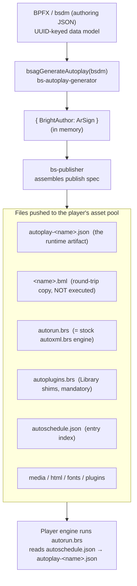
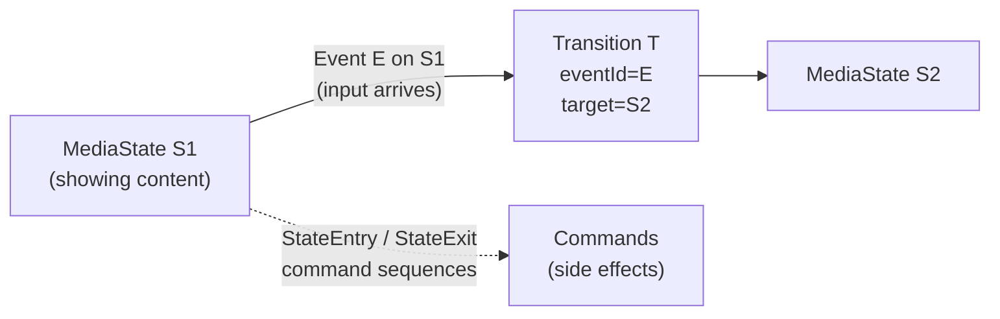

# BrightSign Presentation Format — Reference Specification

A complete, validated reference for the BrightSign presentation format, written for someone
building an independent authoring/management client (a "BrightAuthor:connected from scratch").

It covers **both layers**:

1. **The BPFX authoring format** — the JSON a client reads and writes (`.bpfx` / `.bml`), i.e. the
   serialized presentation data model (`bsdm`).
2. **The player runtime format** — the `autoplay-<name>.json` the player actually executes, and the
   exact field-by-field mapping from authoring to runtime.

The centerpiece is the **eventing/interactivity system** — how hardware and network inputs (UDP,
GPIO, serial, timers, IR, plugin messages) drive a state machine of media.

## Status and provenance

This document supersedes and corrects the draft
`BAConnected/doc/data-model/bpfx-specification-common.md`. Every structural claim here was validated
against **real sample files** and **generator/runtime source code**, cited as `path:line` (BPFX) or
`file + JSON path` (samples). Where this spec disagrees with the draft, the disagreement is called
out explicitly — see [§10 Corrections from the draft](#10-corrections-from-the-draft-spec).

Validated against these sample presentations (schema versions `0.7.6` → `1.3.10`):

- `BAConnected/packages/bsDataModel/examples/input/VideoPlusImage-v7.bpfx` (`0.7.6`)
- `.../VideoPlusImage-v9.bpfx` (`0.9.7`)
- `.../VideoPlusImage-v1-1-4.bpfx` (`1.1.4`)
- `BAConnected/packages/bsnConnector/examples/test_data/bsnPresentationExample.bpfx` (`0.8.2`)
- `.../VideoPlusImage.bpfx` (`0.12.4`)
- `bsDataModel/tests/testFiles/LegacySign-v12-4.json` (`0.12.4`)
- `bs-device-setup/tests/data/presentations/DeviceSetup-Test-1.bpfx` (`1.2.3-alpha-3`)
- `bs-client-ui/.../sample-presentations/udp-test/udp-test.bpfx` (`1.3.10`, the UDP interactivity sample)

Runtime facts validated against the generator (`bs-autoplay-generator`), publisher (`bs-publisher`),
and the runtime engine (`bs-device-artifacts/static/autoxml.brs`).

---

## Table of contents

1. [Orientation: the two layers and the pipeline](#1-orientation-the-two-layers-and-the-pipeline)
2. [Container shapes and versioning (read this first)](#2-container-shapes-and-versioning-read-this-first)
3. [The `bsdm` model — structural reference](#3-the-bsdm-model--structural-reference)
4. [Sign object](#4-sign-object)
5. [Zones and zone layers](#5-zones-and-zone-layers)
6. [Media states and content items](#6-media-states-and-content-items)
7. [The eventing / interactivity system](#7-the-eventing--interactivity-system)
8. [Supporting entities](#8-supporting-entities-data-feeds-user-variables-assets-live-text)
9. [The player runtime format and publish pipeline](#9-the-player-runtime-format-and-publish-pipeline)
10. [Corrections from the draft spec](#10-corrections-from-the-draft-spec)
11. [Enum reference tables](#11-enum-reference-tables)
12. [Source file map](#12-source-file-map)

---

## 1. Orientation: the two layers and the pipeline

A "presentation" exists in two serialized forms. Confusing them is the first trap.

| | Authoring format (BPFX) | Runtime format (autoplay) |
|---|---|---|
| File | `<name>.bpfx` (JSON), or `<name>.bml` (same JSON, published copy) | `autoplay-<name>.json` |
| Root | the `bsdm` data model | `{ "BrightAuthor": {...} }` |
| Who reads it | the authoring client (BrightAuthor:connected, or yours) | the player engine (`autorun.brs`) |
| Identity | entities keyed by **UUID** | states/zones keyed by **name/tag** |
| Purpose | editing, round-trip | execution |

The player never runs a `.bpfx`. It runs the generated `autoplay-<name>.json`. An independent client
must produce both (the `.bml`/`.bpfx` for round-trip editing, and the autoplay for the player), plus a
few fixed support files.



The runtime engine `autorun.brs` is the **stock BrightAuthor:connected engine** (the built
`autoxml.brs`, ~34k lines). Independent clients do **not** author it — they ship it as-is and generate
only the JSON around it (`bs-publisher/src/publishSpecLocal.ts:476-496`).

---

## 2. Container shapes and versioning (read this first)

**The single biggest correction to the draft:** the top-level container is not fixed. The schema
version (`sign.properties.version`, a real `major.minor.patch[-alpha-N]` semver) determines both the
container shape and which fields exist. The draft only accurately describes `1.3.10`.

### 2.1 The three container shapes

Let **`R`** be the model root. A parser must resolve it as **`R = file.bsdm ?? file`**:

| Shape | Versions | Top-level keys | Model root |
|-------|----------|----------------|------------|
| **Bare `bsdm`** | `0.x` (0.7.6–0.12.4) | `sign`, `zones`, `mediaStates`, `events`, … directly | the file itself |
| **`{ bsdm }` wrapper** | `1.1.4` | only `bsdm` | `file.bsdm` |
| **Full editor wrapper** | `1.2.3-alpha+`, `1.3.10` | `bsdm` + editor keys (`eventMenu`, `interactiveCanvas`, `liveText`, `selection`, and in `1.3.10` also `meta`, `screenLayoutSettings`) | `file.bsdm` |

So `R.zones.zonesById.<uuid>` is the portable path; `bsdm.zones...` is valid **only** for `1.1.4+`.

### 2.2 Structural version gating

Every claim below is gated on version. This matrix captures what changes; treat anything marked "→"
as "not present before this version."

| Feature | Introduced |
|---------|-----------|
| `mediaStates` as `{ mediaStatesById, sequencesByParentId }` (before: **flat** UUID→state map) | `0.12.4` |
| `transitions` as `{ transitionsById, sequencesByEventId }` (before: **flat** UUID→transition map) | `0.12.4` |
| `zones.zoneLayerSequence` / `zoneLayersById` / `zoneTagIndices` (before: `{ allZones, zonesById }` only) | `0.12.4` |
| `commands` container | `0.9.7` (absent in `0.7.6`) |
| `customAutorun`, `thumbnail` | `0.9.7` |
| `liveText`, `linkedPresentations`, `partnerProducts` (bsdm members) | `0.12.4` |
| Event `disabled` field | `0.9.7` |
| Event `action` field | `1.x` |
| `nodeApps`, `videoModePlugins` | `1.1.4` |
| `sign.irRemote`, `sign.wssDeviceSpec` | `1.1.4` |
| `{ bsdm }` wrapper | `1.1.4` |
| Serial `port`: **string** (before: **number**) | `1.1.4` |
| Editor keys (`eventMenu`, `selection`, …) | `1.2.3-alpha` |
| `screens`, `userDefinedEvents`, `bmapSpec` (bsdm); `meta`, `screenLayoutSettings` (top level) | between `1.2.3-alpha` and `1.3.10` |
| Most of `sign.properties` (audio config, gps, enhanced sync, `size`, chromium flag) | `1.3.10` |

Two fields dropped over time: zone-property `liveVideoInput` / `liveVideoStandard` exist in `0.x` and
were removed at `0.12.4`.

### 2.3 Portable root-to-target paths

```
R = file.bsdm ?? file
Zone        : R.zones.zonesById[uuid]
Media state : R.mediaStates.mediaStatesById[uuid]   (0.12.4+)  |  R.mediaStates[uuid]   (0.x)
Event       : R.events[uuid]                          (flat, ALL versions)
Transition  : R.transitions.transitionsById[uuid]    (0.12.4+)  |  R.transitions[uuid]  (0.x)
Command     : R.commands.commandsById[uuid]          (0.9.7+; absent in 0.7.6)
```

If you write one parser, key it on `version` and branch these shapes. Everything else is additive.

---

## 3. The `bsdm` model — structural reference

`R` (the model root) contains these members. Presence is version-gated per §2.2; casing is exact.

```typescript
interface BsDmState {
  sign: SignObject;
  zones: ZoneContainer;
  mediaStates: MediaStateContainer | FlatMap<MediaState>; // wrapped 0.12.4+, flat before
  events: { [uuid]: Event };                              // ALWAYS flat, no eventsById wrapper
  transitions: TransitionContainer | FlatMap<Transition>; // wrapped 0.12.4+, flat before
  commands: CommandContainer;                             // 0.9.7+
  dataFeeds: DataFeedContainer;
  userVariables: UserVariableContainer;
  htmlSites: { [uuid]: HtmlSite };                        // flat map
  liveText: LiveTextContainer;                            // 0.12.4+
  assetMap: { [uuid]: Asset };                            // flat map
  auxiliaryFiles: { [uuid]: AuxiliaryFile };              // flat map
  scriptPlugins: { [uuid]: ScriptPlugin };
  parserPlugins: {};                                      // always empty in observed files
  videoModePlugins: {};                                   // 1.1.4+, always empty
  nodeApps: { [uuid]: NodeApp };                          // 1.1.4+
  deviceWebPages: { [uuid]: DeviceWebPage };              // always {} in observed files
  linkedPresentations: LinkedPresentationsContainer;      // 0.12.4+
  partnerProducts: { allProducts: []; productsById: {} }; // 0.12.4+, empty
  customAutorun: "0";                                     // STRING "0" (see note)  0.9.7+
  thumbnail: Thumbnail | null;                            // 0.9.7+

  screens?: ScreensContainer;                             // ~1.3.10
  userDefinedEvents?: UserDefinedEventContainer;          // ~1.3.10
  bmapSpec?: "0";                                         // STRING "0"  ~1.3.10
}
```

> **Type correction:** `customAutorun` and `bmapSpec` are the **string** `"0"`, not numeric `0` and not
> `null` (the draft says `0 | null`). Confirmed in every sample that has them. These are sentinel
> foreign keys, consistent with the string-`"0"` sentinel used everywhere else (§3.1).

Structural invariants (all versions):
- `events`, `htmlSites`, `assetMap`, `auxiliaryFiles` are **flat** UUID maps — no `...ById` wrapper.
- `userVariables` uses the key **`variablesById`** (not `userVariablesById`), and also carries a
  sibling `sequence: UUID[]` (undocumented in the draft).

### 3.1 IDs and sentinels

- All IDs are lowercase v4 UUIDs: `xxxxxxxx-xxxx-4xxx-[89ab]xxx-xxxxxxxxxxxx`.
- **Unset UUID foreign key** → the string `"0"` (e.g. `dataFeedId: "0"`, `userVariableToAssignInput: "0"`).
- **Unset integer foreign key** → the number `0` (e.g. asset `networkId: 0` for local assets).
- `customAutorun` / `bmapSpec` use the string `"0"` even though they are not obviously foreign keys.

---

## 4. Sign object

`R.sign` is global sign configuration. Members are version-gated:

```typescript
interface SignObject {
  properties: SignProperties;
  serialPortConfigurations: SerialPortConfiguration[]; // exactly 8, ports 0..7
  gpio: ("input" | "output")[];                        // exactly 8
  buttonPanels: ButtonPanels;                          // bp900a..d, bp200a..d
  audioSignPropertyMap: { [connector: string]: { min: 0; max: 100 } };
  lastModifiedTime: string;                            // ISO 8601 with ms
  irRemote?: IrRemote;                                 // 1.1.4+
  wssDeviceSpec?: {};                                  // 1.1.4+, always {}
}
```

> **Corrections:** `irRemote` and `wssDeviceSpec` are absent in all `0.x` sign objects (the draft
> lists them unconditionally). `serialPortConfigurations[].port` is a **number** in `0.x` and a
> **string** in `1.x` — do not assume `"0".."7"`.

### 4.1 Sign properties relevant to eventing

`sign.properties` grows from ~31 keys (`0.9.7`) to ~40 (`1.3.10`); the draft's "common" list is really
the `1.3.10` list. The fields that matter for interactivity, confirmed in `udp-test.bpfx`:

```typescript
{
  id: UUID; version: string; name: string; model: string; videoMode: string;
  monitorOrientation: string; backgroundScreenColor: RgbaColor;
  // UDP transport (see §7.4):
  udpDestinationAddressType: "IPAddress" | "LocalSubnet" | "Ethernet";
  udpDestinationAddress: string;   // e.g. "255.255.255.255"
  udpDestinationPort: number;      // e.g. 5000  (outbound)
  udpReceiverPort: number;         // e.g. 5000  (inbound listen port)
  networkedVariablesUpdateInterval: number;  // seconds
  resetVariablesOnPresentationStart: boolean;
  gpsConfiguration?: "None" | "Serial";      // 1.3.10
  enableEnhancedSynchronization?: null | { deviceIsSyncMaster: boolean; ptpDomain: number };
  size?: { width: number; height: number };  // 1.3.10
}
```

Serial port config (each of 8): `{ port, baudRate, dataBits, stopBits, parity, protocol, sendEol,
receiveEol, invertSignals, connectedDevice }`. GPIO array: 8 strings, each `"input"` or `"output"` —
a `Gpio` event requires the corresponding pin be `"input"`.

---

## 5. Zones and zone layers

A presentation is a set of **zones**; each zone is an independent state machine (§7). Zone container:

```typescript
interface ZoneContainer {
  zonesById: { [uuid]: Zone };
  allZones: UUID[];
  zoneLayerSequence?: UUID[];               // 0.12.4+
  zoneLayersById?: { [uuid]: ZoneLayer };   // 0.12.4+
  zoneTagIndices?: { [zoneId: UUID]: number }; // 0.12.4+
}

interface Zone {
  id: UUID;
  name: string;
  type: ZoneType;
  tag: string;                 // IMPORTANT: the runtime uses this as the zone id (§9.2)
  initialMediaStateId: UUID;   // the zone's start state
  nonInteractive: boolean;     // false => build event tables (interactive)
  position: { x; y; width; height; pct: boolean };
  properties: object;          // per zone type
}
```

`ZoneType` values (from `metadata.ts`, and the generator's per-type switch): `VideoOrImages`,
`VideoOnly`, `Images`, `AudioOnly`, `EnhancedAudio`, `Ticker`, `Clock`, `BackgroundImage`, `Control`.
Only `VideoOrImages` appears in the sample set — the others are valid but unconfirmed against samples
here; trust the code enum, not the draft's "confirmed" subset.

> **Correction:** `VideoOrImages` properties in `0.x` include `liveVideoInput` (e.g. `"S-Video"`) and
> `liveVideoStandard` (e.g. `"NTSC-M"`), dropped at `0.12.4`. Not in the draft.

Zone layers (`0.12.4+`) group zones by rendering plane:

```typescript
interface ZoneLayer {
  id: UUID;
  type: "Video" | "Audio" | "Invisible" | "Graphics";
  zoneSequence: UUID[];
  zoneLayerSpecificProperties?: { type: "FourK" | "HD"; index: number;
    enableMosaicDeinterlacer: boolean; sharedDecoder: boolean }; // Video only
}
```

---

## 6. Media states and content items

```typescript
interface MediaStateContainer {           // 0.12.4+; before this, mediaStates is a flat UUID→state map
  mediaStatesById: { [uuid]: MediaState };
  sequencesByParentId: { [parentId: UUID]: UUID[] };  // ordered playlist per container
}

interface MediaState {
  id: UUID;
  name: string;                 // the runtime's state key (uniqueIdentifier)
  tag: string;
  container: { id: UUID; type: number };  // type: 0=Zone, 1=playlist, 2=SuperState child,
                                          //       3=MediaList item, 4=LocalPlaylistItem
  contentItem: ContentItem;     // discriminated by contentItem.type
}
```

A **MediaState** is one node = "what is showing now." All states in a zone share the zone's
`container.id` and form that zone's graph. `sequencesByParentId[containerId]` gives the ordered
playlist for non-interactive playback.

Content item types (discriminated by `type`), confirmed as first-class enum members in code
(the draft's "source-exclusive" split is an artifact of its sample folders — see §10):

`Audio`, `Image`, `Video`, `Html`, `EventHandler`, `MediaList`, `LiveText`, `LiveVideo`, `DataFeed`,
`MjpegStream`, `VideoStream`, `SuperState`, `MrssFeed`, `LocalPlaylist`, `LocalPlaylistItem`,
`PlayFile`, `Clock`.

Representative shapes (newer schema; `0.x` variants are subsets — e.g. `0.9.7` `Image` omits
`defaultTransition`/`transitionDuration`):

```typescript
// Image
{ name; type:"Image"; assetId:UUID; useImageBuffer:boolean; videoPlayerRequired:boolean;
  defaultTransition:string; transitionDuration:number }         // last two: 0.12.4+
// Video
{ name; type:"Video"; assetId:UUID; volume:number; videoDisplayMode:"2D"; automaticallyLoop:boolean }
// LiveText  (used by udp-test)
{ name; type:"LiveText"; canvasId:UUID }
// MediaList (a playlist item container)
{ name; type:"MediaList"; playbackType:string; shuffle:boolean; useDataFeed:boolean;
  dataFeedId:UUID|"0"; transition:string; autoTransitions:boolean; inactivityTimeout:boolean; ... }
// SuperState (a nested state machine)
{ name; type:"SuperState"; initialMediaStateId:UUID }
// EventHandler (a Control-zone logic node)
{ name; type:"EventHandler"; stopPlayback:boolean }
```

---

## 7. The eventing / interactivity system

This is the heart of an interactive presentation. It is a per-zone state machine where **Events**
attached to states listen for inputs, **Transitions** are the edges to the next state, and
**Commands** are side effects fired on lifecycle hooks.

### 7.1 The state machine model



Cross-reference chain (all real JSON paths; UUIDs from `udp-test.bpfx`):

```
mediaStates.mediaStatesById[S]                       ← a node
events[E].mediaStateId == S                           ← event E is armed while node S is active
transitions.transitionsById[T].eventId == E           ← edge T fires when E fires
transitions.transitionsById[T].targetMediaStateId == S2   ← go to node S2
transitions.sequencesByEventId[E] == [T, ...]         ← priority order when E has several branches
commands.sequencesById[Q].parentId == (S | E | T)     ← side-effect hook, keyed by lifecycle
commands.sequencesById[Q].sequence == [C, ...]         ← ordered command IDs
commands.commandsById[C].operations[i].{type, data}   ← the actual operation
```

Two ways an event links to its transition(s) — **a client must support both**:
1. `sequencesByEventId[eventId]` present → an ordered priority list of transition IDs (conditional
   branches evaluated in order, first satisfied wins).
2. `sequencesByEventId` empty (as in the UDP samples) → group `transitionsById` by their `eventId`;
   each event has exactly one unconditional transition.

### 7.2 Event object

```typescript
interface Event {
  id: UUID;
  name: string;
  type: EventType;             // the trigger category
  mediaStateId: UUID;          // the state this event is armed on
  data: object | null;         // type-specific (§7.3)
  disabled: boolean;           // 0.9.7+
  action?: EventIntrinsicAction; // 1.x; None|SeqFwd|SeqBack|ReturnToPriorState|StopPlayback|StopPlaybackAndClearScreen
}
```

### 7.3 Complete Event Type catalog

`EventType` from `bsCore/lib/metadata.ts:769`; data shapes from `bsDataModel/lib/bsDmInterfaces.ts`;
hardware requirements from `bsDmEvents.ts:664`. The `type` string equals the enum member value.

| `type` | `data` fields | Hardware / config required |
|--------|---------------|----------------------------|
| `Timer` | `{ interval: number }` (ms) | none |
| `MediaEndOrTimer` | `{ interval: number }` | none |
| `MediaEnd` | `null` | content with a duration (video/audio/feed/stream/medialist) |
| `MediaListEnd` | `null` | owning content item is `MediaList` |
| `Keyboard` | `{ data: string }` (char, or `<code>` special key) | USB |
| `Remote` (IR) | `{ data: string; buttonDirection: "Down"\|"Up" }` | USB or dedicated IR |
| `Usb` | `{ data } +` [uservar-assign block] | USB |
| `Serial` | `{ port: string; data: string } +` [uservar-assign block] | serial port or USB-tap |
| `Udp` | `{ data; label; export } +` [uservar-assign block] | **networking** (§7.4) |
| `Synchronize` / `InternalSynchronize` | `{ data: string }` | networking |
| `ZoneMessage` | `{ data } +` [uservar-assign block] | none (inter-zone messaging) |
| `Gpio` | `{ buttonNumber: number; buttonDirection: "Down"\|"Up"; pressContinuous: InputControlConfig\|null }` | GPIO pin set to `input` |
| `Button` | `{ buttonNumber; buttonDirection; pressContinuous }` | buttons-by-GPIO |
| `Bp` (BrightPanel) | `{ bpType: "bp200"\|"bp900"\|"gpio"; bpIndex: "a".."d"; buttonNumber: number; pressContinuous }` (`buttonNumber -1` = any) | USB |
| `TimeClock` | `{ type: DmTimeClockEventType; data: {...} }` (4 sub-variants below) | RTC |
| `Gps` | `{ distanceUnits; regionEventData: { direction; radius; latitude; longitude } }` | USB GPS |
| `AudioTimeCode` / `VideoTimeCode` | interval-style; `action` forced `None` | audio / video content |
| `RectangularTouch` | `{ region: { x; y; width; height; pct } \| null }` | USB + video (touchscreen) |
| `PluginMessage` | `{ pluginId: UUID; message: string } +` [uservar-assign block] | script plugin present |
| `WssEvent` | `{ port; wssEventId; wssEventName; wssEventParameter? } +` [uservar-assign block] | WebSocket server |
| `Bmap` | `{ port; functionBlock; function; operator; field; bitfield; data } +` [uservar-assign] | USB (BMAP) |
| `BmapHex` | `{ port; data } +` [uservar-assign block] | USB |
| `UserDefinedEvent` | `{ data: string }` | depends on bound member events (§8) |

**The user-variable assignment block** appears on `Serial`/`Udp`/`Usb`/`ZoneMessage`/`PluginMessage`/
`WssEvent`/`Bmap`/`BmapHex`:

```typescript
{
  assignInputToUserVariable: boolean;      // capture the whole matched input into a variable
  assignWildcardToUserVariable: boolean;   // capture only the wildcard-matched portion
  userVariableToAssignInput: UUID | "0";   // "0" = none
  userVariableToAssignWildcard: UUID | "0";
}
```

**TimeClock sub-variants** (`DmTimeClockEventType`): `timeClockDateTime` → `{ dateTime }`;
`timeClockDateTimeByUserVariable` → `{ userVariableId }`; `timeClockDailyOnce` →
`{ daysOfWeek: bitmask; time }`; `timeClockDailyPeriodic` →
`{ daysOfWeek; startTime; endTime; interval /*minutes*/ }`. `daysOfWeek` is a 0–127 bitmask, bit 0 =
Sunday.

**Continuous-press config** (`pressContinuous`): `{ repeatInterval: seconds; initialHoldoff: seconds }`.

### 7.4 UDP in depth

UDP is a **distinct `EventType` (`"Udp"`)**, not a serial event over UDP. The **inbound listen port is
a Sign property, not per-event**: `sign.properties.udpReceiverPort` (e.g. `5000`).

**Inbound — match a payload and jump states** (real event, `udp-test.bpfx`):

```json
// events["ad8717d2-7583-4000-a281-e7e2fe84e000"]
{
  "type": "Udp",
  "mediaStateId": "ebd570b7-...-b83000",     // armed on the "Waiting for you to select" state
  "disabled": false,
  "data": {
    "data": "breakfast",          // the datagram payload that must match
    "label": "breakfast",         // editor label
    "export": true,
    "assignInputToUserVariable": false,
    "assignWildcardToUserVariable": false,
    "userVariableToAssignInput": "0",
    "userVariableToAssignWildcard": "0"
  },
  "action": "None"
}
// its transition targets the "You Chose Breakfast" state.
```

**Inbound — wildcard capture into a user variable** (feed live UDP text into content without changing
the graph):

```json
{
  "type": "Udp",
  "mediaStateId": "6ab7a9e0-...-560000",
  "data": {
    "data": "<any>",                        // wildcard: matches any datagram
    "label": "Wildcard Receiver",
    "export": true,
    "assignWildcardToUserVariable": true,   // capture ON
    "userVariableToAssignInput": "0",
    "userVariableToAssignWildcard": "4b133253-...-3a3000"  // user variable "UDP Received"
  },
  "action": "ReturnToPriorState"            // pop back after capturing
}
```

The captured text lands in the named user variable, which a `LiveText`/parameterized string then
displays. (The generator bakes the wildcard into a `(.*)` regex at
`bs-autoplay-generator/src/services/autoplayGenerator.ts:3235`.)

**Outbound** — destination is Sign-level (`udpDestinationAddressType` / `udpDestinationAddress` /
`udpDestinationPort`); sending is a **command operation** `sendUdp` (or `sendUdpBytes`):

```json
{ "type": "sendUdp", "data": { "messageData": { "params": [ { "type": "Text", "value": "hello" } ] } } }
```

### 7.5 Transitions

```typescript
interface TransitionContainer {              // 0.12.4+; flat UUID→transition map before
  transitionsById: { [uuid]: Transition };
  sequencesByEventId: { [eventId: UUID]: UUID[] };
}

interface Transition {
  id: UUID;
  name: string;
  type: "No effect";            // only value observed across 47,941 transitions
  duration: 0;                  // always 0
  eventId: UUID;                // the event that fires it
  targetMediaStateId: UUID;     // the next state (or a sentinel for "stay")
  condition?: ConditionalExpression;      // guard (§7.6)
  conditionalAction?: EventIntrinsicAction;
}
```

### 7.6 Conditional transitions

A transition may guard on a user variable:

```typescript
interface ConditionalExpression {
  userVariableId: UUID;
  userVariableName?: string | null;   // display only
  compareOperator: "EQ"|"NEQ"|"GT"|"GTE"|"LT"|"LTE"|"BTW";
  compareValue1: ParameterizedString;
  compareValue2?: ParameterizedString | null;   // only for BTW (between)
}
```

Evaluation: when an event fires, its transitions run in the order given by
`sequencesByEventId[eventId]` (or the single unconditional transition if that map is empty).
Conditional transitions are evaluated first; the first whose comparison is true wins; an unconditional
transition is the default fallback. At most one unconditional transition should exist per event.

### 7.7 Commands catalog

```typescript
interface CommandContainer {
  commandsById: { [uuid]: Command };
  sequencesById: { [uuid]: CommandSequence };
}
interface Command { id: UUID; name: string; operations: { type: CommandType; data: object|null }[]; sequenceId: UUID }
interface CommandSequence { id: UUID; type: CommandSequenceType; parentId: UUID; sequence: UUID[] }
```

`CommandSequenceType` is the lifecycle hook: `StateEntry`, `StateExit`, `Event`, `Transition`,
`ItemNext`, `ItemPrev`.

`CommandType` (from `metadata.ts:1033`), data shapes from `bsDmCommands.ts:210`. Universal operations:

| `type` | `data` |
|--------|--------|
| `sendUdp`, `sendUdpBytes`, `sendZoneMessage`, `sendIRRemote`, `sendProntoIRRemote` | `{ messageData: ParameterizedString }` |
| `setVariable` | `{ userVariableId; userVariableValue: ParameterizedString }` |
| `incrementVariable`, `decrementVariable`, `resetVariable` | `{ userVariableId }` |
| `resetVariables`, `generateSessionGuid`, `clearSessionGuid` | `null` |
| `hideZone`, `showZone`, `pauseZonePlayback`, `resumeZonePlayback` | `{ zoneId }` |
| `setZoneVolume`, `incrementZoneVolume`, `decrementZoneVolume` | `{ zoneId; volume: ParameterizedNumber }` |
| `setConnectorVolume` (+inc/dec), `muteAudioOutputs`, `unmuteAudioOutputs` | connector / `{ connectorList: string[] }` |
| `updateDataFeed` | `{ dataFeedSourceId }` |
| `switchPresentation` | `{ presentationId: UUID\|null; userVariableId: UUID\|null }` |

Hardware / extended operations: `serialSendString`/`serialSendByte`/`serialSendBytes`
(`{ port; messageData; eol? }`), `gpioOn`/`gpioOff` (`{ gpioNumber }`), `gpioSetState`
(`{ gpioState: bitmask }`), `cecDisplayOn`/`cecDisplayOff`/`cecSetSourceToBrightSign`
(`{ videoConnector? }`), `cecSendString` (`{ videoConnector?; hexString; substituteSourceAddress }`),
`pause` (`{ pauseTime }`), `resume`/`pauseVideo`/`resumeVideo`/`reboot`
(`null`), `resizeZone` (`{ zoneId; position }`), `synchronize`/`internalSynchronize`
(`{ messageData }`), `sendPluginMessage` (`{ pluginId; messageData }`), `sendWss`
(`{ wssCommandName; port; wssParameter? }`), `beaconStart`/`beaconStop` (`{ beaconName }`),
`lightOn`/`lightOff` (`{ lightNumber }`), `sendBmap`/`sendBmapHex`, `sendBpOutput`
(`{ bpType; bpIndex; buttonNumber; bpAction }`).

### 7.8 Worked end-to-end trace (real UUIDs)

"Player is in 'Waiting for you to select' and a UDP packet `breakfast` arrives on port 5000":

```
sign.properties.udpReceiverPort = 5000                          (listen here)
  ↓ datagram "breakfast"
events["ad8717d2…"]: type=Udp, data.data="breakfast",
                     mediaStateId="ebd570b7…" (= current state)   → MATCH
  ↓ (sequencesByEventId empty ⇒ find transition by eventId)
transitions.transitionsById["dfdc1141…"]: eventId="ad8717d2…",
                     type="No effect", duration=0,
                     targetMediaStateId="ce376fe8…"
  ↓
mediaStates.mediaStatesById["ce376fe8…"]: name="You Chose Breakfast"   (new active state)
  ↓ (commands.sequencesById is {} ⇒ no side-effect commands)
```

### 7.9 Parameterized values

Used for variable substitution in command data, conditional compare values, user-variable defaults,
HTML query strings, and live text.

```typescript
interface ParameterizedString { params: { type: "Text"|"UserVariable"|"UserVariableName"; value: string }[] }
interface ParameterizedNumber { params: { type: "Number"|"UserVariable"|"UserVariableName"; value: string|number }[] }
```

A value is the ordered concatenation of its params. `Text`/`Number` = literal; `UserVariable` = the
value is a variable **UUID** to substitute; `UserVariableName` = the value is a variable **name**. An
empty `params` array is the unset value. Example: `{ "params": [ { "type": "Text", "value": "$1.00" } ] }`.

---

## 8. Supporting entities (data feeds, user variables, assets, live text)

**User variables** — `userVariables.variablesById[uuid]`, plus a sibling `sequence: UUID[]`:

```typescript
interface UserVariable {
  id: UUID; name: string;
  defaultValue: ParameterizedString;
  access: "Private" | "Shared";
  isNetworked: boolean;
  dataFeedId: UUID | "0";
  systemVariable: null | "EdidManufacturer" | "IPAddressWired" | "SerialNumber" | "EdidManufacturerProductCode";
  data?: object;
}
```

**Data feeds** — `dataFeeds.{ feedsById, sourcesById }`. `DataFeed` has `usage:
"MRSS"|"Content"|"Text"|"MRSSWith4K"`, `feedSourceId`, `parserPlugin:"0"`. `DataFeedSource` has
`type: "BSNDynamicPlaylist"|"URLDataFeed"|"BSNDataFeed"`, `updateInterval`, and type-specific
`dataFeedAssetId` or `url`.

**Asset map** — `assetMap[uuid]` (flat). Ties a presentation reference to a physical/pool file:

```typescript
interface Asset {
  id: UUID; name: string;
  assetType: "Content"|"BSNDynamicPlaylist"|"BrightScript"|"HtmlSite"|"DeviceHtmlSite"|"BSNDataFeed"|"Project";
  locator: string;   // "pool@" | "file:///..." | BSN URL
  path: string; refCount: number; scope: string;
  networkId: number | UUID | null;   // 0 (int) for local; UUID for BSN
  location: "Bsn" | "Local" | null;
  mediaType?: "Audio"|"Image"|"Video"|"Font"|"Auxiliary";  // Content assets only
  fileSize?: number; fileHash?: string; fileUrl?: string; lastModifiedDate?: string; thumbUrl?: string;
}
```

**Live text** — `liveText.{ itemsById, canvasesById, layersByCanvasId }`. A `LiveText` content item
references a canvas; canvas items are `StaticText` / `UserVariable` / `SystemVariable` /
`IndexedDataFeed` / `TitledDataFeed` / `Image`, each with a `position`, `widget`, and `textWidget`.
This is how a captured UDP/serial user variable becomes on-screen text.

**Screens** (`~1.3.10`) — `screens.{ allScreens, screensById }`; each `Screen` carries `videoMode`,
`videoConnector`, `monitorOrientation`, `dimensions`. Note `allScreens` may be shorter than
`screensById` — do not use it as a count.

**User-defined events** (`~1.3.10`) — `userDefinedEvents.{ userDefinedEventsById, sequence }`; a
named bundle of member event specifications that fire together (referenced by the `UserDefinedEvent`
event type).

**Editor-only top-level keys** (`eventMenu`, `interactiveCanvas`, `selection`, top-level `liveText`,
`meta`, `screenLayoutSettings`) are ignored by the player. `meta = { brightAuthorVersion; buildType:
"Standard" }`.

> **Correction:** `screenLayoutSettings` has **no** `layout` sub-object. Real shape:
> `{ selectedLayoutId: null; screenCount: null; isLayoutBoundaryToggled: boolean; selectedBezel: null;
> isSnapToCanvasToggled: boolean }` — `selectedLayoutId`/`screenCount` are nullable, not the enum
> strings/numbers the draft lists.

---

## 9. The player runtime format and publish pipeline

### 9.1 The artifact set

The generator `bsagGenerateAutoplay(bsdm)`
(`bs-autoplay-generator/src/services/autoplayGenerator.ts:320`) produces `{ BrightAuthor: ArSign }`.
`bs-publisher` (`publishSpecLocal.ts:712`) writes these files into the player's asset pool:

| File | Role |
|------|------|
| `autoplay-<name>.json` | **the runtime artifact** — one per presentation (`publishSpecLocal.ts:343`) |
| `<name>.bml` | round-trip authoring copy (JSON), **not executed** (`:363`) |
| `autorun.brs` | the stock engine (the built `autoxml.brs`, renamed) (`:476-496`) |
| `autoplugins.brs` | generated `Library "<plugin>.brs"` shims; **mandatory** even if empty (`:369-402`) |
| `autoschedule.json` | schedule index; names the active autoplay file (`:597-617`) |
| `featureMinRevs.json`, `PartnerProducts.json`, media/html/fonts/plugins | support + assets |

The runtime artifact is **JSON**, not XML/`.bml`/zip. (`facon/src/autoplay.ts` is a minimal
image-only generator producing the same `{ BrightAuthor: {...} }` shape — a good concrete example.)

### 9.2 BPFX → runtime field mapping (the string-token contract)

The generator (bsdm → JSON) and the runtime (`autoxml.brs`, JSON → BrightScript) are two halves of one
contract. **The string tokens match literally on both sides** — reproducing them exactly is the
load-bearing requirement.

**Zones** — `getZoneMetadata` emits `{ id: zone.tag, name, type, absolutePosition, nonInteractive,
initialMediaStateName, percentagePosition }` (`autoplayGenerator.ts:1654`). Note **`id` is the zone
`tag`**, not the UUID. Runtime `newZoneHSM` switches on the identical `type` strings
(`autoxml.brs:7649`).

**States** — each media state becomes an object keyed by **exactly one type field** that selects its
kind: `imageItem`, `videoItem`, `audioItem`, `html5Item`, `liveVideoItem`, `videoStreamItem`,
`audioStreamItem`, `mjpegStreamItem`, `mrssDataFeedItem`, `localPlaylistItem`, `textItem`,
`mediaListItem`, `playFileItem`, `eventHandlerItem`, `templatePlaylistItem` (LiveText), `superStateItem`,
`clockStateItem`, `userVariableInTickerItem` (`autoplayGenerator.ts:1739`). Plus `name`
(= `uniqueIdentifier`), `entryCommands`, `exitCommands`. Runtime reads exactly those keys
(`autoxml.brs:30110`).

**Events → transitions** — an authored Event + Transition become an `ArTransition`
`{ sourceMediaState, userEvent:{ name, data }, targetMediaState, eventAction, assign*Variable*,
commands, conditionalTransitions }` (`autoplayGenerator.ts:3683`). The **`userEvent.name` token** is
the contract:

| Authored `EventType` | runtime `userEvent.name` | runtime handler |
|----------------------|--------------------------|-----------------|
| `Gpio` (and `Button`, remapped) | `gpioUserEvent` | `autoxml.brs:7898` |
| `Bp` (BP200/900 A–D) | `bp900AUserEvent` … `bp200DUserEvent` | `autoxml.brs:7919` |
| `Timer` | `timeout` (or `null` if interval 0) | `autoxml.brs:7996` |
| `MediaEnd` / `MediaListEnd` | `mediaEnd` / `mediaListEnd` | `8116` / `8159` |
| `Udp` | `udp` | `autoxml.brs:8197` |
| `Serial` | `serial` | `autoxml.brs:7950` |
| `ZoneMessage` | `zoneMessage` | `autoxml.brs:8220` |
| `Keyboard`/`Remote`/`Usb` | `keyboard`/`remote`/`usb` | `8163`/`8177`/`8187` |
| `TimeClock` / `Gps` | `timeClockEvent` / `gpsEvent` | `8088` / `7936` |
| `WssEvent` / `Bmap` / `BmapHex` | `wssEvent` / `bmapEvent` / `bmapHexEvent` | `8037` / `8015` / `8001` |

> **Hardware remap you must reproduce:** an authored `Button` event is rewritten to a GPIO event with
> `buttonNumber → buttonNumber*2` before emission (`autoplayGenerator.ts:3396`), per "LED N on GPIO
> 2N and button N on GPIO 2N+1". The runtime keys GPIO transitions by that doubled number.

**Commands** — emitted as `{ <arCommandName>: [ { <paramName>: [ { type:'text'|'userVariable', value } ] } ] }`,
where `<arCommandName>` comes from the frozen `ArCommands` table (`arConstants.ts`), e.g. `gpioOn →
gpioOnCommand`. The runtime `ExecuteCmd` dispatches on the identical strings
(`autoxml.brs:25596`).

### 9.3 Execution model

1. **Boot** — `autorun.brs` (`autoxml.brs`) `Main()` sets up the message port + watchdog, then
   `RunBsp` builds the player state machine (`autoxml.brs:415`).
2. **Schedule → presentation** — reads `autoschedule.json`, computes
   `autoplay-<presentation>.json`, locates it in the asset pool (`autoxml.brs:29441`).
3. **Parse** — `newSign` parses the autoplay JSON: `meta`, then each zone into a hierarchical state
   machine (`newZoneHSM`), building states (`stateTable`) and per-state event tables (`newTransition`)
   (`autoxml.brs:5278`).
4. **Run** — each zone HSM enters its initial state (plays media, runs entry commands), then waits on
   the shared message port for `roGpioButton`/`roVideoEvent`/zone messages/serial/udp/timer/etc. A
   matching event triggers `ExecuteTransition` → run transition commands → exit old state → enter
   target state. `switchPresentation` tears down and restarts with a new autoplay.

> `default-autorun.brs` and `libBRS/mediaPlayer.brs` are **not** the presentation runtime — they are
> the first-run provisioning/setup engine that runs only when no valid `autorun.brs` exists. A
> successfully provisioned player downloads the real `autorun.brs` (= `autoxml.brs`) and reboots.

### 9.4 What an independent client must generate

To make a presentation play and respond to input on a real player, produce into the asset pool:

1. **`autorun.brs`** — ship the stock engine (published `autoxml.brs`); version-matched. You do not
   author this.
2. **`autoplugins.brs`** — mandatory (`Main` does `Library "autoplugins.brs"`). One `Library "<x>.brs"`
   line per script plugin; empty otherwise.
3. **`autoschedule.json`** — `{ scheduledPresentations: [ { presentationToSchedule: { name, fileName,
   filePath }, dateTime, duration, allDayEveryDay, recurrence } ] }`; the active `name` must match the
   autoplay filename stem.
4. **`autoplay-<name>.json`** — the presentation:
   - `BrightAuthor.version = 1`, `type = "publish"`.
   - `BrightAuthor.meta`: at least `name`, `videoMode`, `size{width,height}`, `model`,
     `monitorOrientation`, `backgroundScreenColor`, plus the collections the parser expects to exist
     (`userVariables`, `scriptPlugins`, `parserPlugins`, `videoModePlugins`, `htmlSites`, `nodeApps`,
     `liveDataFeeds`, `dataFeedSources`, `graphicsZOrder`). Use `facon/src/autoplay.ts:65-747` as a
     complete accepted `meta` example.
   - `BrightAuthor.zones[]`: `{ id (=zone tag), name, type, absolutePosition, percentagePosition,
     nonInteractive, zoneSpecificParameters, playlist }`.
   - `zone.playlist`: `{ name, type:"interactive"|"non-interactive", initialMediaStateName, states[],
     transitions[] }`.
   - `states[]`: each keyed by exactly one type field + `name` + `entryCommands` + `exitCommands`.
   - `screens` (may be `[]`).
5. **Assets** referenced by `filePath`/`fileName`.

For input responsiveness: set `zone.nonInteractive = false` and `playlist.type = "interactive"`; add
`transitions[]` entries whose `userEvent.name` is one of the runtime tokens in §9.2 and whose
`commands` use the literal `ArCommands` names with `{ paramName: [ { type, value } ] }` params.

---

## 10. Corrections from the draft spec

The draft (`bpfx-specification-common.md`) is a solid structural skeleton but has systematic errors,
most stemming from (a) validating only `1.3.10`-era files and (b) partitioning features by which of
three sample folders they appeared in. Concrete corrections:

**Structural**
1. **Container shape is not fixed.** Three shapes exist (bare `bsdm` / `{ bsdm }` / full wrapper). Use
   `R = file.bsdm ?? file`. The draft's absolute `bsdm.*` paths are `1.1.4+` only.
2. **`version` is a real semver** (`0.7.6`…`1.3.10`, sometimes `-alpha-N`), not a two-value enum.
3. **`mediaStates` and `transitions` are flat UUID maps before `0.12.4`** (no `...ById` wrapper).
4. **Zone-layer keys, `irRemote`, `wssDeviceSpec`, event `action`/`disabled`, `nodeApps`, `screens`,
   `userDefinedEvents`, and most of `sign.properties` are version-added**, not "common."

**Type errors**
5. `customAutorun` and `bmapSpec` are the **string `"0"`**, not numeric `0`/`null`.
6. `serialPortConfigurations[].port` is a **number in `0.x`**, string in `1.x`.
7. `screenLayoutSettings` has **no `layout` sub-object**; its `selectedLayoutId`/`screenCount` are
   nullable.

**Omissions**
8. `userVariables.sequence` (sibling of `variablesById`) is undocumented.
9. Zone `0.x` properties `liveVideoInput` / `liveVideoStandard` are undocumented.

**Framing**
10. The "source-exclusive" appendix demotes genuinely first-class features. Every event type
    (`Gpio`, `Keyboard`, `Serial`, …), content type (`SuperState`, `PlayFile`, …), and command
    (`gpioOn`, `reboot`, `cecSendString`, `serialSendString`, `resizeZone`, …) the draft lists as
    "source-exclusive" is a first-class enum member in `metadata.ts`. Treat them as part of the
    format, with observed prevalence as a footnote — not as second-class extensions.

---

## 11. Enum reference tables

**Player models (observed):** `XT1144`, `HS145`, `XT1145`, `LS424`, `XT2145`, `LS445`, `XC4055`,
`XT1143`, `HD224`, `LS425`, `XC2055`, `HD1024`, `XD1035`, `AU335`, `LS423`, `HS124`, `HD1025`, `HD225`,
`XD234`, `XT244`.

**Video modes:** `1920x1080x60p|50p|30p|29.97p`, `1920x1200x60p`, `1280x720x60p`,
`3840x2160x60p|50p|30p|24p|23.976p`, `0x0x0p` (audio-only, AU335).

**Event actions (`EventIntrinsicAction`):** `None`, `SeqFwd`, `SeqBack`, `ReturnToPriorState`,
`StopPlayback`, `StopPlaybackAndClearScreen`.

**Command sequence types:** `Event`, `StateEntry`, `StateExit`, `Transition`, `ItemNext`, `ItemPrev`.

**Compare operators:** `EQ`, `NEQ`, `GT`, `GTE`, `LT`, `LTE`, `BTW`.

**Image transitions (observed):** `No effect`, `Fade to background color`, `Fade to new image`,
`Slide from top|bottom|left|right`, `Image wipe from right|left`.

---

## 12. Source file map

**Authoring format / data model**
- `BAConnected/packages/bsDataModel/lib/bsDmInterfaces.ts` — every entity interface (`DmEvent`,
  `DmTransition`, `DmCommand`, `DmMediaState`, …)
- `.../lib/bsDmEvents.ts`, `bsDmCommands.ts` — event/command builders + hardware compatibility
- `BAConnected/packages/bsCore/lib/metadata.ts` — the enums (`EventType`, `CommandType`,
  `CompareOperator`, `CommandSequenceType`, `StringParameterType`, …)
- `BAConnected/packages/bs-bpf-converter/src/bpfToJson.ts` — classic `.bpf` ↔ JSON conversion

**Runtime / publish**
- `BAConnected/packages/bs-autoplay-generator/src/services/autoplayGenerator.ts`, `commandGenerator.ts`
  — bsdm → autoplay JSON
- `.../src/interfaces.ts`, `arConstants.ts` — `ArSign`/`ArTransition` shapes, `ArCommands` token table
- `BAConnected/packages/bs-publisher/src/publishSpecLocal.ts` — publish spec + filenames
- `BAConnected/packages/bs-device-artifacts/static/autoxml.brs` — the runtime engine (event/command
  dispatch)
- `bsn-core/facon/src/autoplay.ts` — minimal example generator
- `bsn-core/default-autorun/` — first-run provisioning engine (not the presentation runtime)

**Sample presentations** — see [Status and provenance](#status-and-provenance).

**Superseded draft** — `BAConnected/doc/data-model/bpfx-specification-common.md`; conceptual
companions `data-model-definition.md`, `data-model-implementation.md`.

---

*Last updated: 2026-08-18. Validated against sample files v0.7.6–v1.3.10 and generator/runtime source.*
